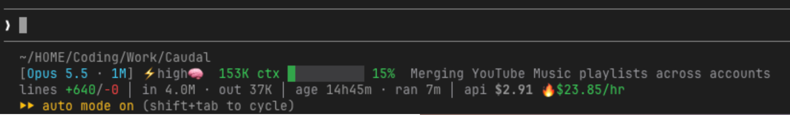
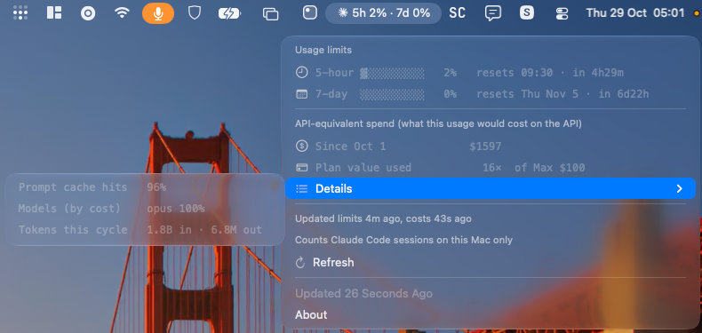

# claude-code-meter

A status line for [Claude Code](https://code.claude.com) that shows git state, context use, session tokens, cost and burn rate, and a warning when a 5-hour or 7-day limit is about to run out. There's also an optional macOS menu-bar view through [SwiftBar](https://swiftbar.app).

```
~/code/my-project  main* +2 ~1 ?3 ↑1  PR#12 ✓
[Opus 5.5 · 1M] ⚡high🧠  245K ctx ▓▓▓░░░░░░░ 24%  my-session  [Auto]
lines +540/-30 │ in 3.2M · out 85K · main 92% · agents 8% │ age 5h10m · ran 42m │ api $4.10 🔥$5.86/hr
5h ▲1.6× caps ~1h10m │ this session 5h 30% · 7d 8%        (only when a limit is about to be hit)
```



The optional SwiftBar menu-bar view (macOS):



## Install

Open Claude Code and say:

> Install the status line from https://github.com/yash201040/claude-code-meter

Claude clones the repo and follows [INSTALL.md](INSTALL.md). It checks the requirements, asks before overwriting any file or setting, and runs a test render. The SwiftBar menu is optional, and Claude asks whether you want it.

You need `bash`, `jq`, `python3` (3.8 or newer) and `git`, on macOS or Linux.

## Notes

- Everything stays on your machine. The scripts read the data Claude Code passes to the status line and your local session transcripts, and they write only to `~/.cache/cc-statusline/`. Nothing is sent anywhere.
- Costs are API-equivalent estimates: what the usage would cost at API prices. On a subscription, use them for scale, not as a bill. They count only Claude Code sessions on this machine.
- [INSTALL.md](INSTALL.md) explains each line, the options and how to uninstall.

## Credits

Based on the original status line by [@FoCDoT](https://github.com/FoCDoT), then extended and optimized here, with the SwiftBar menu added.

## License

MIT, see [LICENSE](LICENSE). An unofficial community project, not made by or affiliated with Anthropic.
