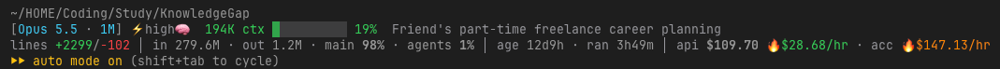
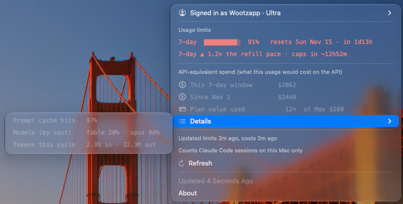

# claude-code-meter

A status line for [Claude Code](https://code.claude.com) that shows git state, context use, session tokens, cost, and burn rate for the session and the whole account. An optional macOS menu-bar view through [SwiftBar](https://swiftbar.app) shows the 5-hour and 7-day limits and the signed-in account.

```
~/code/my-project  main* +2 ~1 ?3 ↑1  PR#12 ✓
[Opus 5.5 · 1M] ⚡high🧠  245K ctx ▓▓▓░░░░░░░ 24%  my-session  [Auto]
lines +540/-30 │ in 3.2M · out 85K · main 92% · agents 8% │ age 5h10m · ran 42m │ api $4.10 🔥$5.86/hr · acc 🔥$9.40/hr
```



The optional SwiftBar menu-bar view (macOS):



## Install

Open Claude Code and say:

> Install the status line from https://github.com/yash201040/claude-code-meter

Claude clones the repo and follows [INSTALL.md](INSTALL.md). It checks the requirements, asks before overwriting any file or setting, and runs a test render. The SwiftBar menu is optional, and Claude asks whether you want it.

You need `bash`, `jq`, `python3` (3.8 or newer) and `git`, on macOS or Linux.

## Notes

- The status line stays on your machine. It reads the data Claude Code passes to it and your local session transcripts, and writes only to `~/.cache/cc-statusline/`.
- The SwiftBar menu makes one request a minute to Anthropic's usage endpoint, the one `/usage` reads, because only it reports per-model weekly limits such as Fable. Clicking Refresh in the menu asks again at once (at most every 10 seconds) and recounts the costs too. If the endpoint refuses (it is rate-limited), the menu waits 5 minutes and says so. It uses the login token Claude Code keeps in the macOS Keychain, only for that request: the token is never stored, refreshed or sent anywhere else. If the request fails, the menu shows the all-models figures from the status line instead.
- Switching Claude accounts (`/login`) is handled: the limits shown are always the signed-in account's. Costs and burn rates count every Claude Code session on this machine, whichever account ran it.
- Costs are API-equivalent estimates: what the usage would cost at API prices. On a subscription, use them for scale, not as a bill. They count only Claude Code sessions on this machine.
- [INSTALL.md](INSTALL.md) explains each line, the options and how to uninstall.

## Credits

Based on the original status line by [@FoCDoT](https://github.com/FoCDoT), then extended and optimized here, with the SwiftBar menu added.

## License

MIT, see [LICENSE](LICENSE). An unofficial community project, not made by or affiliated with Anthropic.
